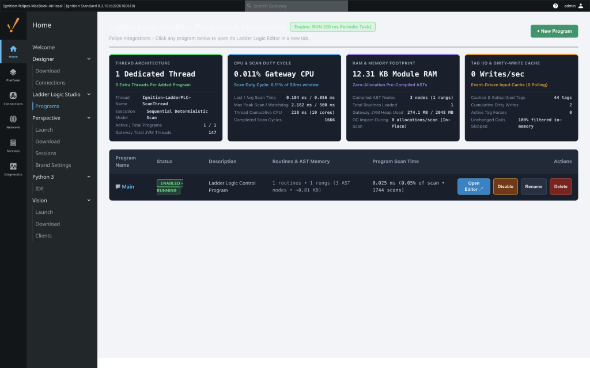
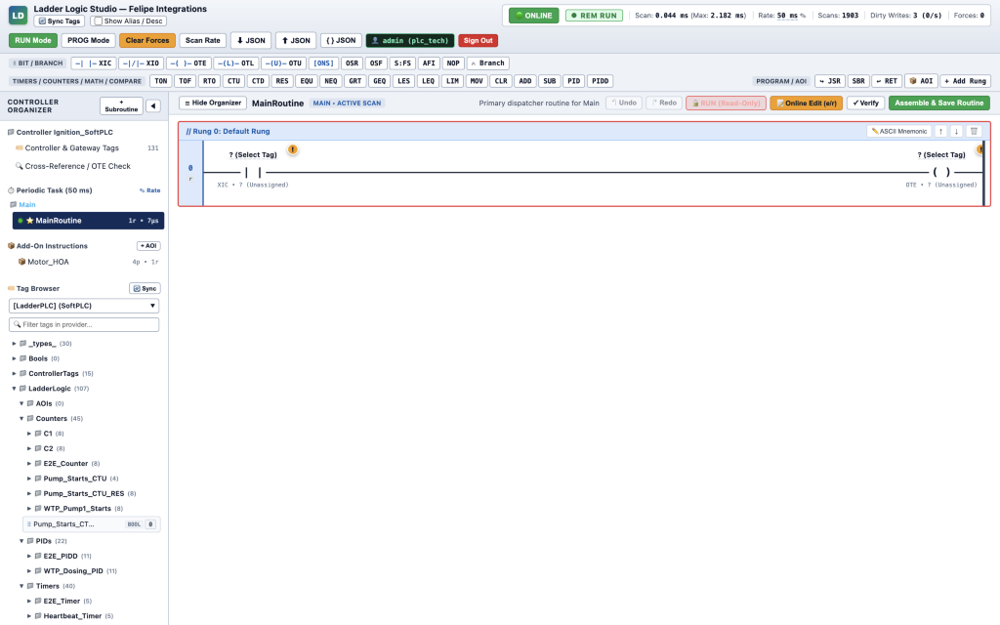
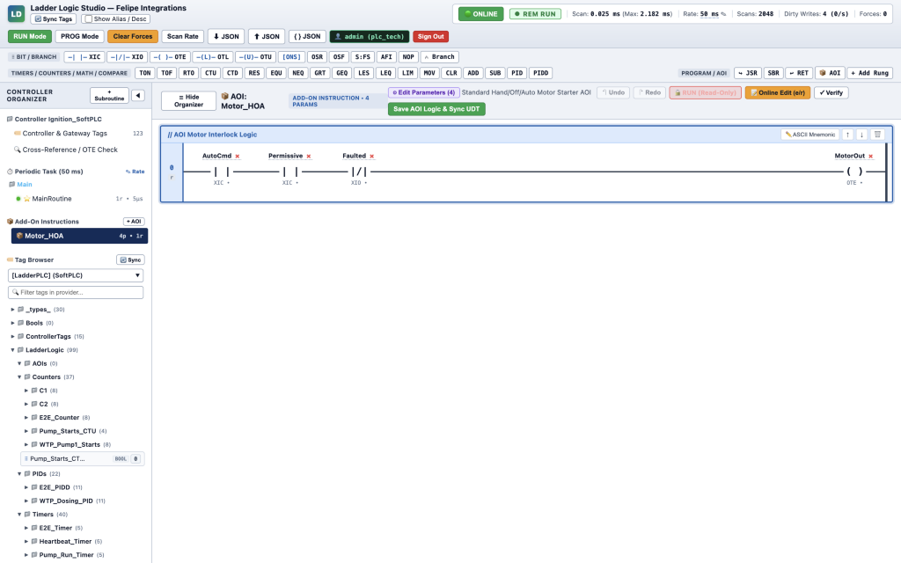
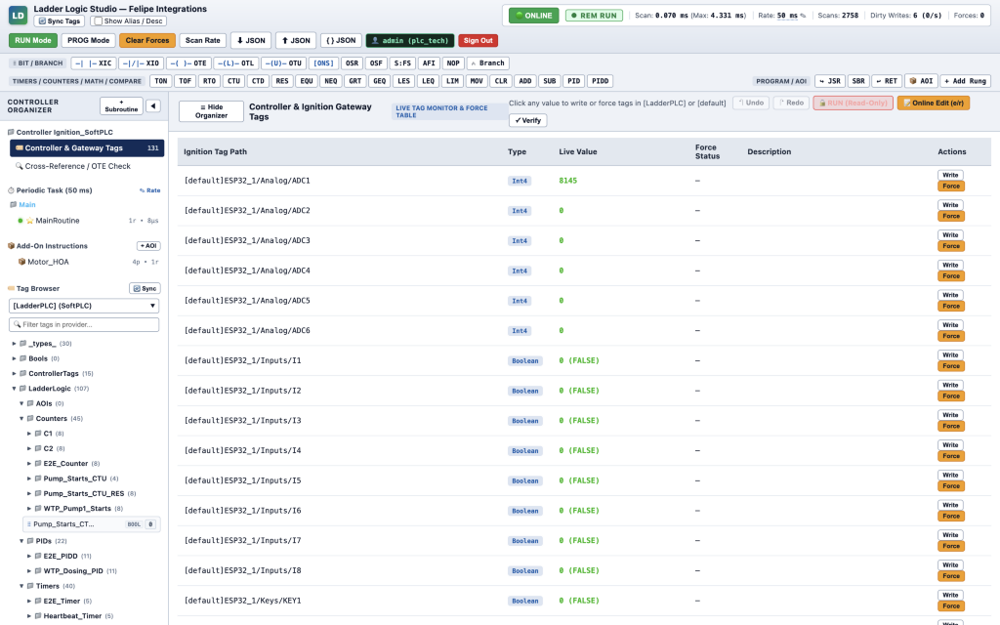
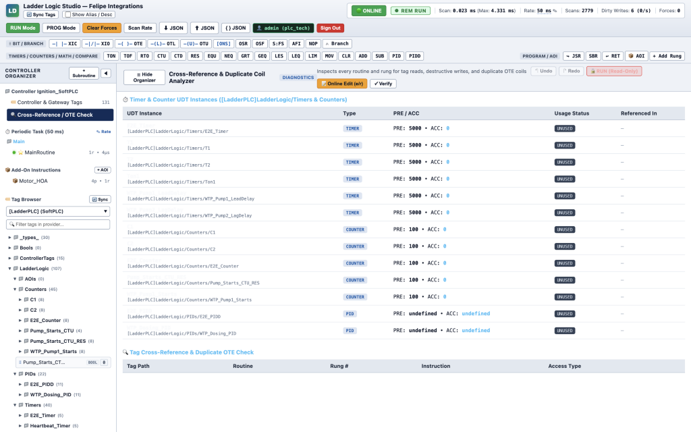
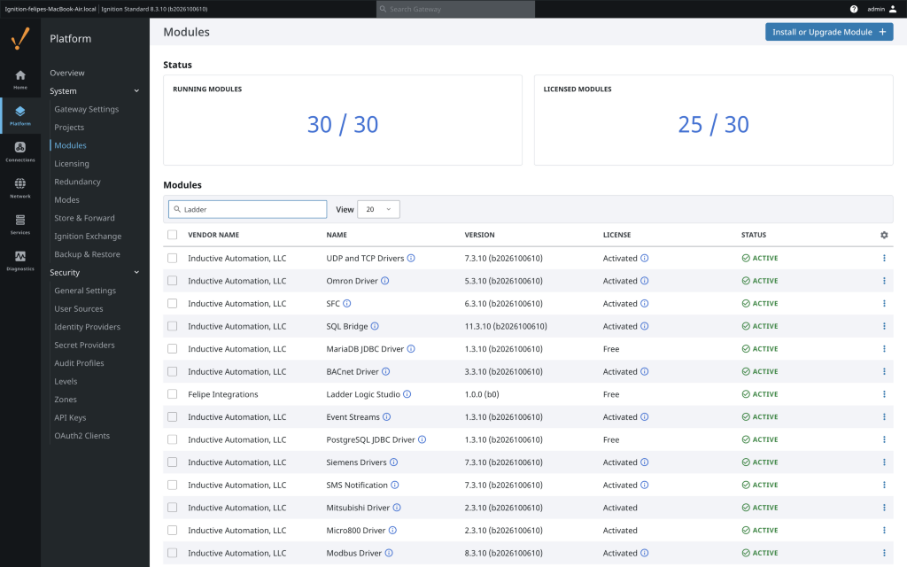

<div align="center">

# ⚡ Ignition Ladder Logic Studio (`ignition-ladder-plc`)

**Industrial Ladder Logic SoftPLC Engine & Browser-Based Ladder Logic Editor for Inductive Automation's Ignition Platform (8.1 & 8.3)**

[](https://github.com/felipemvcab/ignition-ladder-plc/releases/latest)
[](https://github.com/felipemvcab/ignition-ladder-plc/releases/latest)
[](https://github.com/felipemvcab/ignition-ladder-plc/releases/latest)
[](LICENSE)

[**📥 Download Latest Signed `.modl` (v1.0.0)**](https://github.com/felipemvcab/ignition-ladder-plc/releases/latest) • [**🌐 Live Showcase Portal**](https://felipemvcab.github.io/ignition-ladder-plc/) • [**📸 Screenshots**](#-screenshots) • [**📖 Instruction Set**](#-supported-instruction-set) • [**🚀 Quick Start**](#-installation--quick-start)

</div>

---

## 🔍 Overview

**Ladder Logic Studio** (`com.antigravity.ladderplc`) is a self-contained, zero-dependency **Gateway-scoped SoftPLC module** for Inductive Automation's Ignition SCADA platform. It embeds a deterministic cyclic ladder logic execution engine and a rich, browser-based visual **Ladder Logic Editor**—designed with a very similar look and feel to the most common industrial PLC editors—directly inside the Ignition Gateway, requiring no external PLC hardware or desktop IDE.

All controller tags, UDT structures (`TIMER`, `COUNTER`, `PID`), and Add-On Instruction (`AOI`) instances are automatically synchronized in real time with a dedicated Ignition Managed Tag Provider (`[LadderPLC]`), making every tag immediately browsable and read/write accessible from **Perspective**, **Vision**, **Tag Scripts**, and **OPC-UA**.

---

## 📸 Screenshots

### 1. Ignition Gateway — Programs & Deterministic Scan Engine Diagnostics (`/app/ladder-programs`)
Real-time thread architecture, scan duty cycle, zero-allocation AST memory footprint, and dirty-write cache telemetry right inside the Ignition Gateway sidebar:



### 2. Embedded Ladder Logic Editor (`/system/ladder`)
Familiar industrial PLC editor look and feel with drag-and-drop instruction palettes, Controller Organizer, live `[LadderPLC]` Tag Browser, online editing (`e/r` rungs), and ASCII mnemonic input:



### 3. Reusable Add-On Instructions (`AOI` Logic & UDT Sync)
Create modular, parameterized Add-On Instructions (such as `Motor_HOA`) that automatically synchronize their custom UDT definition with Ignition's Tag Manager:



### 4. Live Controller & Gateway Tag Monitor + Force Table
Inspect and write live values across `[LadderPLC]` or `[default]` tag providers and apply hardware/HMI tag forces directly from the browser:



### 5. Cross-Reference & Duplicate Coil (`OTE`) Analyzer
Automatically audits every routine and rung for tag reads, destructive writes, timer/counter UDT usage, and duplicate `OTE` coil warnings:



### 6. Ignition Gateway Modules Configuration (`/app/platform/system/modules`)
Installs cleanly as a signed, free Gateway-scoped Ignition module (`com.antigravity.ladderplc`):



---

## ✨ Key Features

- **⚡ Deterministic Cyclic Scan Engine (`CyclicScanEngine`)**
  - Configurable scan period with sub-millisecond multi-subroutine execution (~25–100 µs per full scan).
  - Full parallel branch evaluation (`BST` / `NXB` / `BND`), nested branches, seal-in circuits, and rung-condition-in tracking.
  - Subroutines & Program Control (`JSR`, `SBR`, `RET`, `JMP`, `LBL`, `ONS`, `OSR`, `OSF`, `S:FS`, `AFI`, `NOP`).
  - Add-On Instructions (`AOI`) with isolated local parameters and instance data structures.
- **🏷️ Native Ignition Managed Tag Provider (`[LadderPLC]`)**
  - Automatically registers `[LadderPLC]ControllerTags/...` with live UDT structures for Timers (`.PRE`, `.ACC`, `.EN`, `.TT`, `.DN`), Counters (`.PRE`, `.ACC`, `.CU`, `.CD`, `.DN`, `.OV`, `.UN`), and PID loops.
  - **Dirty-Write Batching**: Only pushes tag changes to Ignition's Tag Manager when values actually mutate, eliminating tag event bus flooding.
  - **Hardware / HMI I/O Override & Tag Forcing**: Force any boolean or numeric tag ON/OFF/value from the Ladder Logic Editor regardless of scan logic.
- **🖥️ Embedded Browser-Based Ladder Logic Editor (`/system/ladder`)**
  - Familiar look and feel modeled after the most common industrial PLC editors, featuring drag-and-drop and mnemonic rung editing with live green power-flow energization rails.
  - Multi-rung selection (`Shift+Click`), copy/paste, undo/redo, online edit (`e/r`) mode, and inline tag value editing.
  - Built-in **Cross-Reference & Duplicate Coil Analyzer**, **Live Tag Monitor & Force Table**, and **Routine/AOI Organizer**.
  - Native **Ignition 8.3 Gateway Sidebar Navigation** (`/app/ladder-programs`) plus standalone Web IDE endpoint (`/system/ladder`).
- **📦 Dual Ignition 8.3 & 8.1 Compatibility**
  - Signed `.modl` builds provided for both **Ignition 8.3+** (`jakarta.servlet`, Java 17) and **Ignition 8.1+** (`javax.servlet`, Java 11).

---

## 📥 Downloads

Grab the pre-built, self-signed `.modl` files directly from the [**Latest GitHub Release**](https://github.com/felipemvcab/ignition-ladder-plc/releases/latest):

| Target Platform | Module File | Java / Servlet ABI | Direct Download |
| :--- | :--- | :--- | :--- |
| **Ignition 8.3.x** | `LadderLogic-SoftPLC-1.0.0.modl` | Java 17 / `jakarta.servlet` | [**Download for 8.3**](https://github.com/felipemvcab/ignition-ladder-plc/releases/download/v1.0.0/LadderLogic-SoftPLC-1.0.0.modl) |
| **Ignition 8.1.x** | `LadderLogic-SoftPLC-1.0.0-Ignition8.1.modl` | Java 11 / `javax.servlet` | [**Download for 8.1**](https://github.com/felipemvcab/ignition-ladder-plc/releases/download/v1.0.0/LadderLogic-SoftPLC-1.0.0-Ignition8.1.modl) |

---

## 🧰 Supported Instruction Set

| Category | Instructions | Description |
| :--- | :--- | :--- |
| **Bit & Relay Logic** | `XIC`, `XIO`, `OTE`, `OTL`, `OTU`, `ONS`, `OSR`, `OSF`, `S:FS`, `AFI`, `NOP` | Examine If Closed/Open, Output Energize, Latch/Unlatch, Rising/Falling One-Shots, First Scan Bit (`S:FS`), Always False (`AFI`), No Operation (`NOP`) |
| **Parallel Branching** | `BST`, `NXB`, `BND` | Branch Start, Next Branch, Branch End (supports nested parallel branches) |
| **Timers & Counters** | `TON`, `TOF`, `RTO`, `CTU`, `CTD`, `RES` | On-Delay Timer, Off-Delay Timer, Retentive Timer On, Count Up, Count Down, Reset |
| **Comparison** | `EQU`, `NEQ`, `GRT`, `GEQ`, `LES`, `LEQ`, `LIM` | Equal, Not Equal, Greater Than, Greater/Equal, Less Than, Less/Equal, Limit Test |
| **Move & Math** | `MOV`, `CLR`, `ADD`, `SUB`, `MUL`, `DIV` | Move Value, Clear Register/Bit, Add, Subtract, Multiply, Divide |
| **Process Control (PID)** | `PID`, `PIDD` | Analog Closed-Loop `PID` Controller (0–100% CV) & Digital Time-Proportioned Relay `PIDD` Controller (with anti-chatter dwell delay) |
| **Program Flow & AOI** | `JSR`, `SBR`, `RET`, `JMP`, `LBL`, `AOI` | Jump to Subroutine, Subroutine Input Parameter, Return, Jump to Label, Label, Custom Add-On Instructions (`AOI`) |

---

## 🚀 Installation & Quick Start

1. **Install the Module**
   - In your Ignition Gateway web UI, navigate to **Platform → System → Modules** (or **Config → System → Modules** in Ignition 8.1).
   - Click **Install or Upgrade Module** and upload `LadderLogic-SoftPLC-1.0.0.modl` (for 8.3) or `LadderLogic-SoftPLC-1.0.0-Ignition8.1.modl` (for 8.1).
   - Accept the self-signed certificate from **Felipe Integrations**.
2. **Open the Ladder Logic Editor**
   - **Ignition 8.3**: Click **Ladder Logic Studio → Programs** in the Gateway navigation sidebar, or visit:
     ```text
     http://<your-gateway-ip>:8088/system/ladder
     ```
   - **Ignition 8.1**: Visit `http://<your-gateway-ip>:8088/system/ladder`.
3. **Browse Live Tags in Designer**
   - Open the **Ignition Designer** → Tag Browser → select the **`LadderPLC`** tag provider.
   - All PLC tags under `[LadderPLC]ControllerTags/` update live and can be dragged directly onto Perspective or Vision views.

---

## 🏗️ Architecture

```
┌─────────────────────────────────────────────────────────────────────────┐
│                        Ignition Gateway (8.1 / 8.3)                     │
│                                                                         │
│  ┌───────────────────────────────┐    ┌──────────────────────────────┐  │
│  │   LadderStudioServlet         │    │  ManagedTagProvider          │  │
│  │   (/system/ladder Web IDE)    │    │  ([LadderPLC] Tag Provider)  │  │
│  └──────────────┬────────────────┘    └──────────────▲───────────────┘  │
│                 │ REST / JSON Snapshot               │ Dirty-Write      │
│                 ▼                                    │ Batch Sync       │
│  ┌───────────────────────────────────────────────────┴───────────────┐  │
│  │                      CyclicScanEngine                             │  │
│  │  • MnemonicCompiler (BST/NXB/BND AST Builder)                     │  │
│  │  • MainRoutine ──► JSR Subroutines & AOI Instances                │  │
│  │  • TagImageManager & UdtTimerCounterManager (Force Table + I/O)   │  │
│  └───────────────────────────────────────────────────────────────────┘  │
└─────────────────────────────────────────────────────────────────────────┘
```

---

## 🛠️ Building from Source

```bash
# Requires JDK 17+ and Ignition SDK libraries
./build.sh
```

The build script compiles the Gateway sources, executes the automated scan engine & randomized instruction validation suite (`InstructionValidationSuite`), benchmarks 1,000 multi-subroutine scans, and outputs signed `.modl` binaries in `build/dist/`.

---

## 📄 License

Released under the [MIT License](LICENSE) by **Felipe Integrations** ([@felipemvcab](https://github.com/felipemvcab)).
*Independent community module; not an official product of Inductive Automation.*
